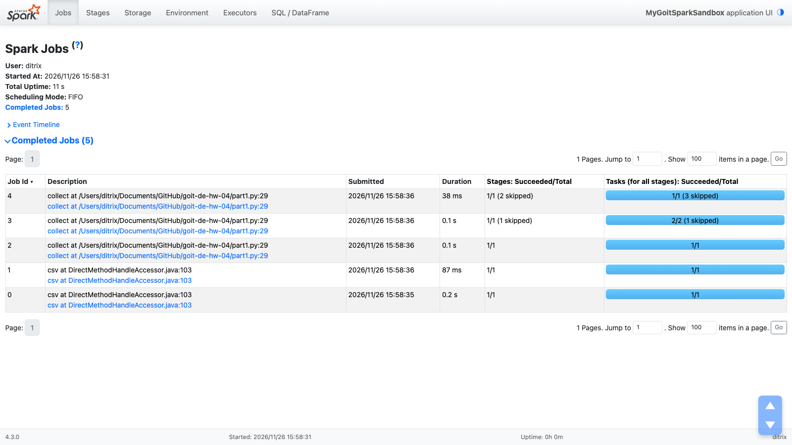
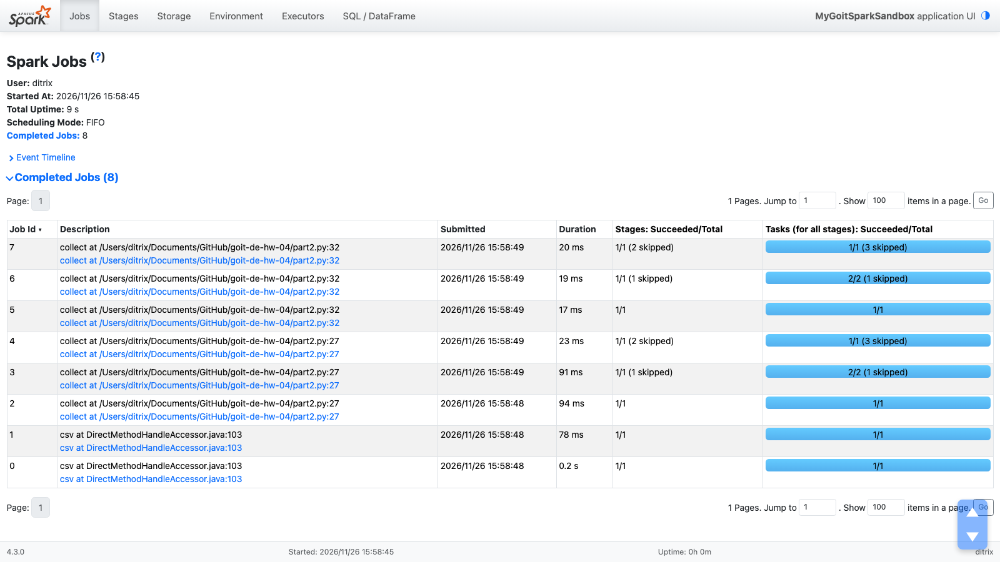
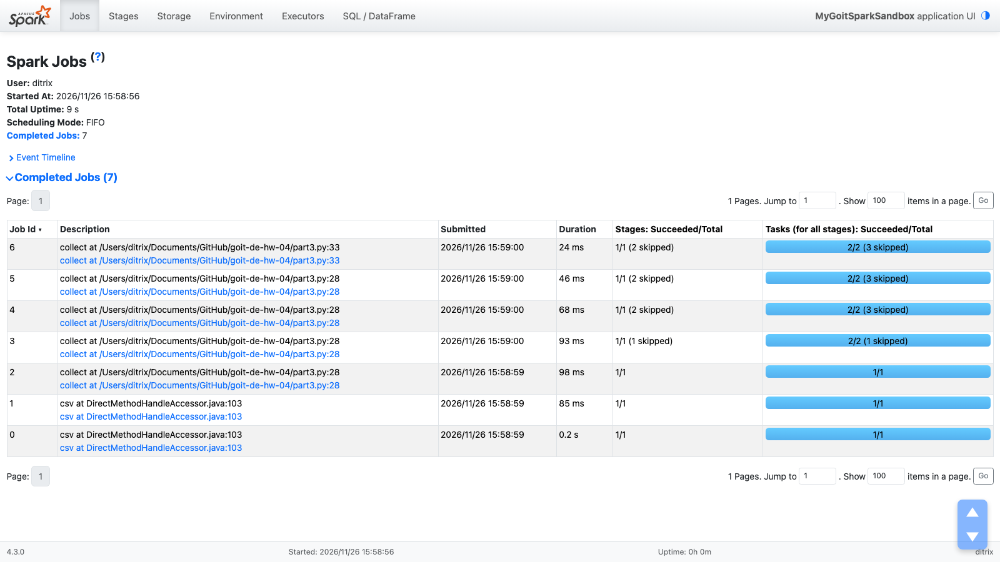

# goit-de-hw-04

Домашнє завдання 4. Apache Spark. Оптимізація та SparkUI.

## Запуск

```bash
pip install pyspark
python part1.py   # далі part2.py, part3.py
```

Потрібна Java 17 або 21 (`JAVA_HOME`). Датасет лежить у `files/nuek-vuh3.csv`.
Поки скрипт чекає на Enter, сторінка Jobs доступна за адресою http://localhost:4040/jobs/.

Середовище: PySpark 4.3.0, OpenJDK 21, `local[*]`, `spark.sql.shuffle.partitions = 2`.
Adaptive Query Execution (AQE) увімкнений за замовчуванням.

## Що спільне для всіх трьох програм

Jobs **0** і **1** (`csv at ...`) з'являються ще до першого `collect()`, на етапі читання CSV:

- **Job 0** читає перший рядок файлу, щоб отримати заголовок (`header=true`).
- **Job 1** проходить увесь файл, щоб визначити типи колонок (`inferSchema=true`).

Кожен `collect()` запускає окреме SQL-виконання. Через AQE план ділиться на query stages
по межах shuffle, і кожна межа стає окремою Job. У нашому плані два shuffle
(`repartition(2)` і `groupBy`), тому один `collect()` дає **3 Jobs**:

1. Читання CSV, `where`, `select`, запис shuffle для `repartition(2)`.
2. Часткова агрегація `count` і запис shuffle за ключем `unit_id`. Попередній stage тут показано як *skipped*: його результат уже записано.
3. Фінальна агрегація, фільтр `count>2` і передача результату драйверу. Два попередні stages показано як *skipped*.

## Частина 1: 5 Jobs

[part1.py](part1.py): один action `collect()`.



**5 = 2 (читання CSV) + 3 (один `collect`).** Фільтр `where("count>2")` не додає Job:
це narrow-трансформація, яка виконується в тому ж stage, що й фінальна агрегація.

## Частина 2: 8 Jobs

[part2.py](part2.py): перед фільтром додано проміжний `collect()`.



**8 = 2 (читання CSV) + 3 (перший `collect`, рядок 27) + 3 (другий `collect`, рядок 32).**

Чому одна дія додала одразу 3 Jobs: DataFrame лінивий і результати проміжних обчислень
не зберігає. Другий `collect()` стосується нового DataFrame (`nuek_processed` + `where`),
тож Spark будує для нього новий план і виконує весь ланцюжок заново: знову читає CSV,
знову робить обидва shuffle. Звідси знову 3 Jobs. Job 5 знову виконує повне читання
файлу, і його stage не позначено як skipped.

## Частина 3: 7 Jobs

[part3.py](part3.py): проміжний результат позначено `.cache()`.



**7 = 2 (читання CSV) + 4 (перший `collect`, рядок 28) + 1 (другий `collect`, рядок 33).**

- Jobs **2, 3, 4**: ті самі три етапи обчислення агрегату. Job 4 при цьому записує результат у кеш (`InMemoryRelation`, вкладка Storage).
- Job **5**: читає щойно закешовані дані (`InMemoryTableScan`) і повертає їх драйверу. Тому перший `collect` має на одну Job більше, ніж у частині 2.
- Job **6**: другий `collect` із фільтром `count>2` читає готовий результат із пам'яті. CSV більше не читається, повторного shuffle немає, тому потрібна лише **1 Job** замість 3. Попередні stages показано як *skipped*: вони є в lineage, але не виконуються.

### Навіщо `cache()`

`cache()` зберігає обчислений DataFrame у пам'яті (для DataFrame рівень за замовчуванням
`MEMORY_AND_DISK`). Виклик лінивий: дані потрапляють у кеш під час першої дії.
Усі наступні дії над цим DataFrame або похідними від нього читають готовий результат
і не перераховують увесь ланцюжок (читання файлу, shuffle, агрегацію). Кешувати варто
DataFrame, який використовується кілька разів. Коли він більше не потрібен,
пам'ять звільняють через `unpersist()`.

| Частина | Читання CSV | 1-й `collect` | 2-й `collect` | Разом |
|---|---|---|---|---|
| 1 | 2 | 3 | — | **5** |
| 2 | 2 | 3 | 3 | **8** |
| 3 | 2 | 4 | 1 | **7** |
